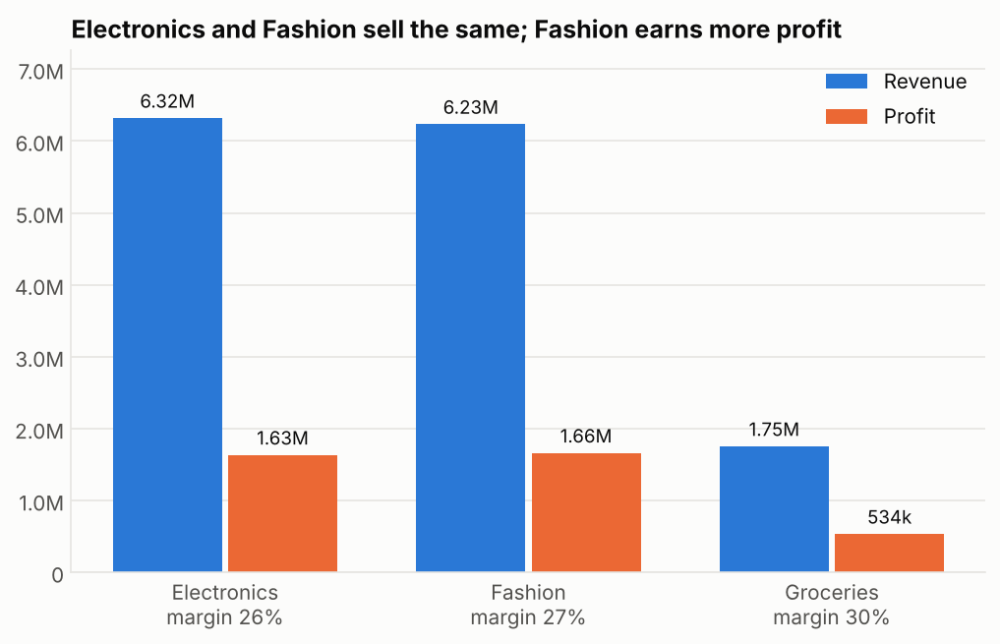
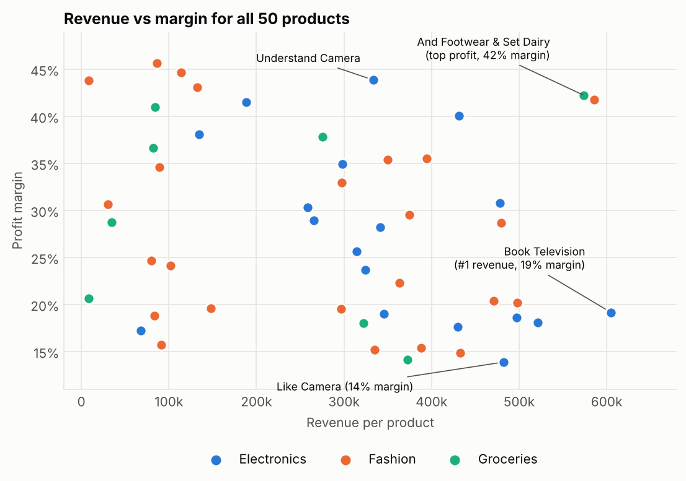
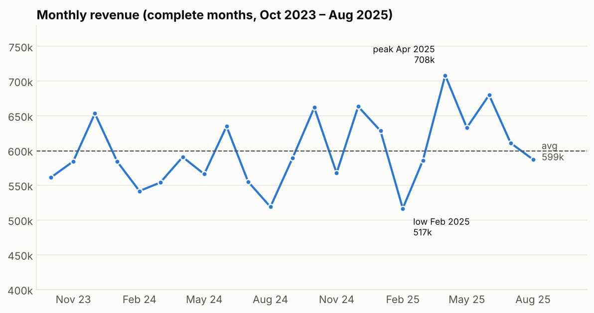
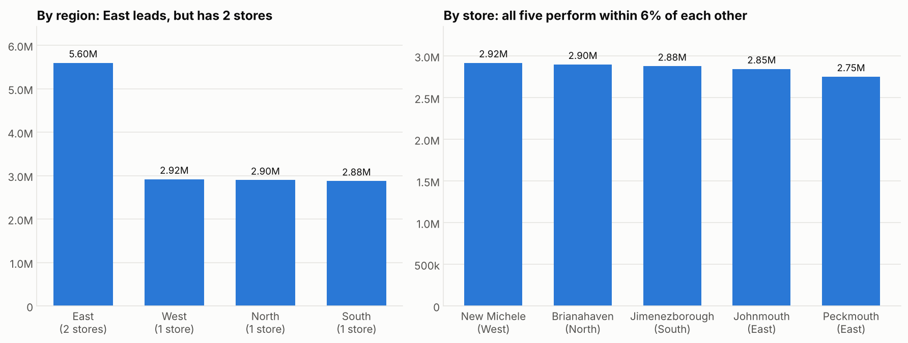
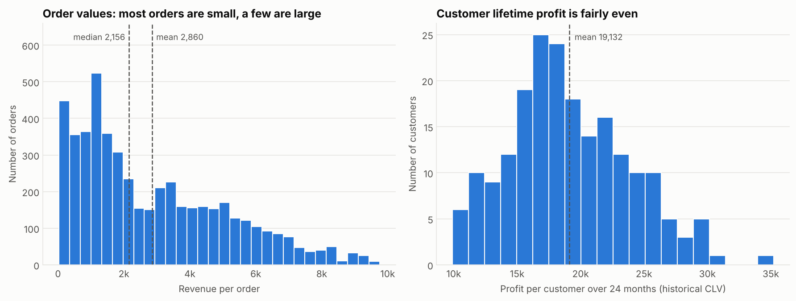
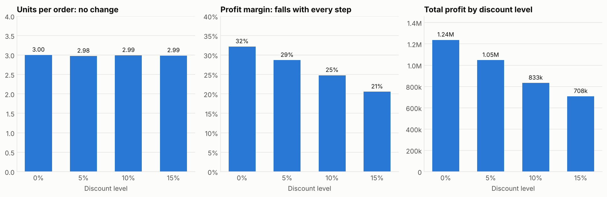

# Task 1 · Exploratory Data Analysis on Retail Sales Data

**Objective:** explore a retail sales dataset to uncover patterns, customer behaviour trends and actionable business insights.

## Business questions
1. Which products and categories drive the most sales and profit?
2. What is the trend of sales over time (monthly / quarterly / yearly)?
3. Which stores or regions perform best?
4. How do customer demographics (age, gender, city) influence sales?
5. What is the average order value and customer lifetime value?
6. How do discounts affect revenue?

## Dataset
`data/retail_sales_dataset.xlsx` is a four-sheet workbook covering **10 Sep 2023 – 9 Sep 2025**:

| Sheet | Rows | Description |
|---|---|---|
| Customers | 200 | Gender, birth date, city, join date |
| Products | 50 | Category, sub-category, unit price, cost price |
| Stores | 5 | Store city and region |
| Transactions | 5,000 | Date, customer, product, store, quantity, discount, payment method |

## Project structure
```
Task1-Retail-EDA/
├── data/                              raw workbook
├── notebooks/
│   ├── 01_cleaning_and_features.ipynb   load, validate, merge, engineer features
│   └── 02_business_questions.ipynb      answers Q1–Q6 with charts and insights
├── scripts/
│   └── make_slide_figures.py            larger-text versions of five charts for the presentation
├── outputs/
│   ├── retail_clean.csv                 cleaned, merged dataset (5,000 rows)
│   └── figures/                         all charts as PNG (slides/ = presentation versions)
├── requirements.txt
└── README.md
```

## Approach
1. **Clean and validate** – check types, missing values, duplicates, key integrity and business rules.
2. **Engineer features** – `Revenue = Quantity × UnitPrice × (1 − Discount)`, `Profit = Revenue − Quantity × CostPrice`, margin, date parts, customer age.
3. **Analyse** – one section per business question: numbers first, then a chart, then a plain-language takeaway.
4. **Check claims** – differences between groups are tested statistically (t-test / ANOVA) before being called real.

### Data cleaning summary
- **No missing values, no duplicate rows, no orphan keys**; every product is priced above cost.
- **Data-quality issue:** 996 of 5,000 transactions (19.9%, across 75 customers) are dated *before* the customer's `JoinDate`. The sales are valid, so rows were kept and flagged (`BeforeJoinDate`); `JoinDate` was not used in the analysis.
- Partial periods are handled explicitly: the data starts and ends mid-month, so 2023 and 2025 are partial years and trends use complete months or like-for-like periods.

## Feature checklist coverage
| # | Requirement | Where in `02_business_questions.ipynb` |
|---|---|---|
| 1 | Initial inspection: shape, dtypes, nulls | *Initial inspection* section (and Part 1 notebook) |
| 2 | Descriptive statistics: mean, median, mode, std | *Descriptive statistics* table |
| 3 | Monthly and quarterly sales trends (line charts) | Q2 (monthly line chart; quarterly bars with partial quarters flagged) |
| 4 | Customer age groups and gender breakdown | Q4 |
| 5 | Top 10 best-selling products; revenue by category | Q1 (top 10 by units, top 10 by profit, category bars) |
| 6 | Correlation heatmap | *Correlation between numeric variables* |
| 7 | Extra visualisation with a non-obvious insight | *Price tiers*: the priciest quarter of products earns 42% of revenue at the thinnest margin (23%) |
| 8 | Written observations after each chart | Markdown cell after every chart |
| 9 | Conclusion with 3+ actionable recommendations | *Conclusion* table (8 recommendations) |

## Key findings

| Question | Finding |
|---|---|
| **Q1 Products & categories** | Electronics (6.32M) and Fashion (6.23M) each deliver ~44% of revenue, but **Fashion earns the most profit (1.66M)**. Groceries has the best margin (30%). Smartphones are the top sub-category by profit (575k). The #1 product by revenue, *Book Television*, has only a 19% margin, while *And Footwear* and *Set Dairy* earn 42%. |
| **Q2 Sales trend** | Steady growth: **Jan–Aug 2025 is +8.9% vs Jan–Aug 2024**. Monthly revenue stays between 517k and 708k (peak Apr 2025). Seasonality is weak; margin is stable at 26–28%. |
| **Q3 Stores & regions** | East leads (5.60M) **only because it has two stores**. Per store, all five are within 6% of each other (2.75M–2.92M); best store is New Michele (West). |
| **Q4 Demographics** | Men bring in more total revenue only because there are more of them (113 vs 87). **Spend per customer is the same** across gender (p = 0.93) and age bands (p = 0.55). City is unique to each customer, so it can't be analysed. |
| **Q5 AOV & CLV** | **AOV 2,860** (median 2,156). Historical CLV: **~71.5k revenue and ~19.1k profit per customer** over 24 months (≈9.6k profit/year). ~25 orders per customer; top 20% of customers = 26.5% of revenue (not concentrated). |
| **Extra insight** | **Units sold are the same in every price tier** (24–26%), so the priciest quarter of products brings 42% of revenue (cheapest quarter: 6%), but at the thinnest margin (23% vs 32%). |
| **Q6 Discounts** | **Discounts do not raise sales volume** (≈3.0 units per order at every level, p = 0.97) but cost **1.17M (7.6% of list sales)**. Margin falls from 32% (no discount) to 21% (15%). |

### Recommendations
1. Judge products by **profit, not revenue**; promote high-margin lines and review pricing/costs on laptops, cameras and accessories.
2. Growth comes from **volume with stable margins**, so focus on acquiring customers rather than seasonal campaigns.
3. **Cut or test removing discounts** (e.g. in one store first): the data shows no volume benefit, and profit could rise by up to ~30% if volume holds.
4. Don't over-invest in age/gender targeting; capture a broader **location** field (region/country) to enable geographic analysis.
5. Share best practice from the top-performing store; no store needs rescuing.
6. Test **small price rises or cost cuts on high-priced, low-margin lines** (laptops, accessories, headphones): volume does not fall as prices rise.

### Selected charts
| | |
|---|---|
|  |  |
|  |  |
|  |  |

## Limitations
- Only 24 months of data, so 2023 and 2025 are partial years.
- Findings are **observational**: they show associations, not proven causes (e.g. the discount result would need a controlled test to prove).
- No currency or customer region in the dataset, which limits the geographic view.
- CLV is a *historical* measure (profit actually earned); the 3-year projection in the notebook rests on an assumption.

## How to run
```bash
pip install -r requirements.txt
cd notebooks
jupyter notebook          # run 01_cleaning_and_features.ipynb first, then 02_business_questions.ipynb
```
